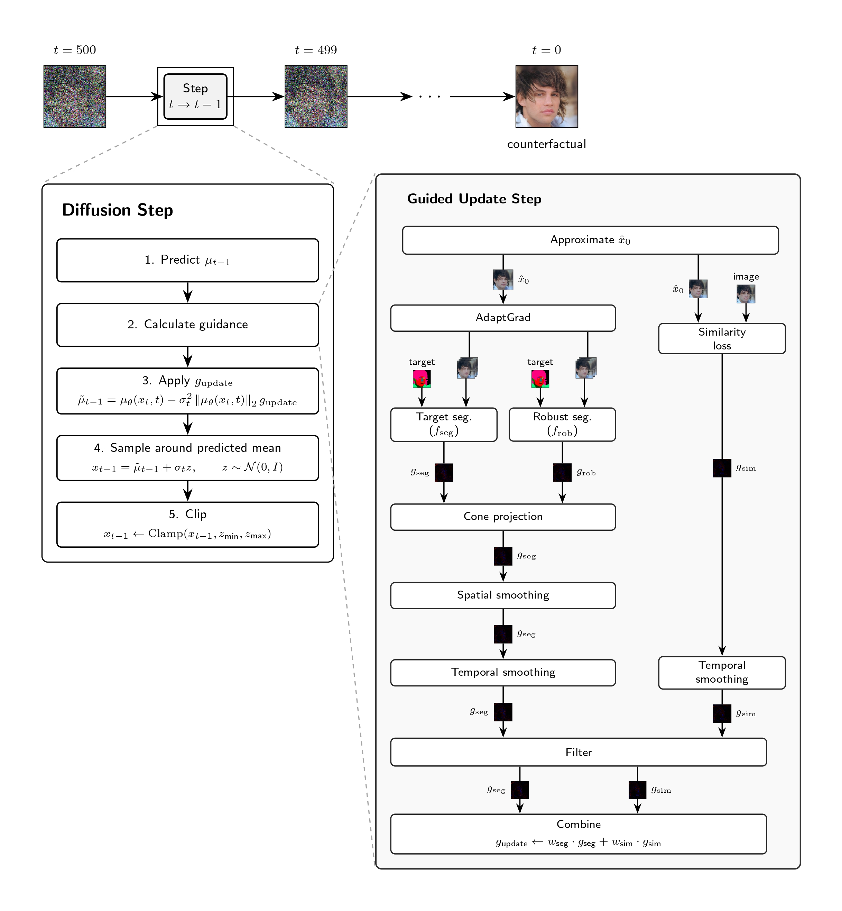

# Diffusion Visual Counterfactual Explanations for Semantic Segmentation Models

Code used for my Master thesis.
In this project I investigated the possibilities for creating visual counterfactuals for semantic segmentation models using diffusion model for realistic image modifications.

## How does it work
The general concept is based on the work of Augustin et al. [1]. They created the counterfactual by guiding the diffusion process in the direction of the wanted classification model output. 
In my work I replaced the classification model with a segmentation U-Net and added some methods for noice reduction and focusing the gradient on important part for the segmentation.
This why the pipeline was able to create visual counterfactuals that give an understandable explanations for segmentation error.

## Train the models
All used segmentation models and diffusion models were trained on the CelebAMask dataset [2]. 

### Diffusion model

### Segmentation model

## Run the counterfactual generation

## References
[1] Augustin, Maximilian, et al. "Diffusion visual counterfactual explanations." Advances in Neural Information Processing Systems 35 (2022): 364-377.
[2] Lee, Cheng-Han, et al. "MaskGAN: Towards Diverse and Interactive Facial Image Manipulation." Proceedings of the IEEE/CVF Conference on Computer Vision and Pattern Recognition (CVPR), 2020.